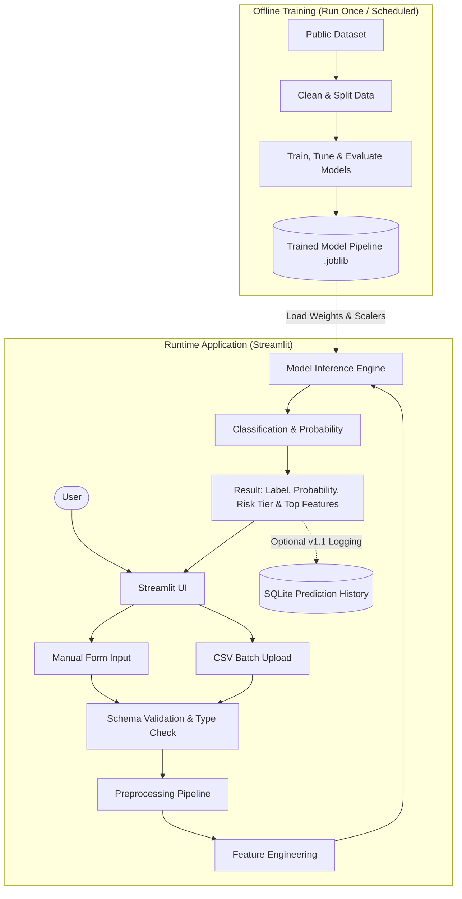

# Fake Social Media Account Detection Using Machine Learning
An end-to-end machine learning system for detecting fake, spam, and bot accounts using public profile attributes and behavioral metadata.

---

## 1. Project Title
**Fake Social Media Account Detection Using Machine Learning**  
*An interpretable, feature-engineered classification system for social media account verification and risk assessment.*

---

## 2. Overview
Social media platforms are increasingly targeted by automated bots, fake spam accounts, and malicious impersonators. These accounts are deployed to artificially inflate follower counts, distribute misinformation, execute phishing schemes, and manipulate public opinion.

This project delivers an end-to-end, reproducible Machine Learning (ML) solution designed to classify accounts as either **Genuine** or **Fake/Bot** based on tabular profile attributes, activity signals, and derived network patterns. The model processes structured feature vectors without requiring invasive scraping or access to private user data.

### Real-World Use Cases
- **Trust & Safety Triage:** Serves as a first-line filter for moderation teams to prioritize high-risk accounts for human verification.
- **Fake-Follower Audits:** Helps digital marketing and brand safety analysts assess influencer audience integrity prior to commercial sponsorships.
- **Fraud & Registration Screening:** Evaluates new or flagged registrations against known bot behavioral footprints during platform onboarding.
- **Academic Research:** Enables empirical study of social bot architectures, account lifecycle patterns, and evolving manipulation tactics using standardized public datasets.

---

## 3. Objectives
- Develop an end-to-end classification pipeline comparing baseline, tree-based, and ensemble algorithms on public social media datasets.
- Ensure strict separation between model training and evaluation using leak-free preprocessing transformations (`ColumnTransformer` and `Pipeline`).
- Deliver an interactive, student-friendly Streamlit web application supporting both single-account manual prediction and bulk CSV batch processing.
- Provide risk-stratified predictions (Low, Review, High) paired with calibrated class probabilities and local feature attribution.
- Establish a reproducible engineering baseline with fixed random seeds, pinned dependencies, modular architecture, and comprehensive unit tests.

---

## 4. Scope

### v1 (MVP - Current Scope)
- **Manual Input Form:** Single-account inspection UI accepting standard profile fields with instant prediction.
- **CSV Batch Upload & Download:** Ingestion of multi-account CSV files, schema validation, batch inference, and result export with risk tags.
- **Probabilistic Classification:** Prediction label (`Genuine` vs. `Fake/Bot`) accompanied by confidence probability.
- **Three-Tier Risk Level:** Rule- and threshold-based assignment (`Low Risk`, `Needs Review`, `High Risk`).
- **Feature Contribution:** Identification and display of the top profile attributes driving the classification outcome.
- **Model Performance Page:** Interactive visualization of cross-validation metrics, confusion matrices, ROC curves, and PR curves.
- **Exploratory Data Analysis (EDA) Page:** Interactive charts displaying feature distributions, class balance, and correlation heatmaps.

### v1.1 (Planned Enhancements)
- **Prediction History:** Local SQLite database integration to persist and review past manual and batch audit sessions.
- **SHAP Explanations:** TreeSHAP / KernelSHAP waterfall plots for granular local feature impact analysis.

### Later / Optional Additions
- **FastAPI Microservice:** Dedicated REST endpoint (`POST /predict`) for headless programmatic integration.
- **Containerization:** Production Docker image for platform-independent deployment.
- **Second-Platform Model:** Dedicated Twitter/X model operating on platform-specific schema without cross-polluting datasets.
- **Text & NLP Features:** Natural language analysis on user biographies (sentiment, word embeddings, linguistic cues).

### Explicitly Out of Scope
- **Live Platform Scraping:** No headless browser or automated scraping against live social media platforms.
- **Private Account Inspection:** No capability or attempt to view private profiles, protected posts, or direct messages.
- **Real-Time Feed Monitoring:** No real-time event streaming or automated account suspension workflows.

---

## 5. Requirements

### Functional Requirements
- **FR1 (Manual Prediction):** The system must accept user-entered account profile attributes via a web form and return a classification within the UI.
- **FR2 (CSV Batch Processing):** The system must ingest CSV files containing account records, validate the schema against required columns, and perform batch inference.
- **FR3 (Inference Output):** Every prediction must output the binary label (`Genuine` or `Fake/Bot`), the predicted probability, a risk tier (`Low`, `Review`, `High`), and the top contributing features.
- **FR4 (Model Performance Dashboard):** The application must provide a dedicated view presenting validation metrics, confusion matrices, and ROC/PR curves from offline evaluation.
- **FR5 (EDA Dashboard):** The application must provide interactive visual summaries of dataset distributions, feature correlations, and class splits.
- **FR6 (Prediction History - v1.1):** The system will persist prediction inputs, timestamps, and model outputs into a lightweight SQLite database for auditing.
- **FR7 (Exportable Results):** The system must allow users to download batch inference results as an annotated CSV file.

### Non-Functional Requirements
- **Latency:** Single-account inference response time must be under 1.0 second on standard consumer hardware.
- **Reproducibility:** All preprocessing, feature generation, data splitting, and model training operations must use fixed random seeds (`random_state=42`) with pinned dependencies.
- **Modularity:** Source code must follow strict separation of concerns (configuration, loading, preprocessing, training, inference, UI).
- **Error Handling:** All user inputs and uploaded files must undergo strict validation with friendly, descriptive error messages (no raw stack traces).
- **Tooling Constraints:** The project strictly utilizes free, open-source software libraries.
- **Privacy & Data Minimization:** No personal data or credentials are saved or transmitted to external third-party services.

### Hardware & Software Requirements
- **Hardware:** Standard consumer laptop/desktop with a minimum of 8 GB RAM; no dedicated GPU required.
- **Operating System:** Platform-independent (Windows 10/11, macOS, or Linux).
- **Python Version:** Python 3.10 or higher.
- **Environment & Tooling:** Git, VS Code or JupyterLab/Jupyter Notebook.

---

## 6. Tech Stack

| Tool | Purpose | Required? |
| :--- | :--- | :--- |
| **Python** (3.10+) | Core programming language | Required |
| **Pandas** | Tabular data manipulation, aggregation, and batch processing | Required |
| **NumPy** | Numerical array operations and mathematical transformations | Required |
| **Scikit-learn** | Preprocessing pipelines, standard ML algorithms, and metrics | Required |
| **Matplotlib** | Foundational plotting and static visualization generation | Required |
| **Seaborn** | Statistical data visualization for EDA and evaluation reports | Required |
| **Streamlit** | Interactive front-end application and model audit dashboard | Required |
| **joblib** | Serialization and loading of trained pipelines and transformers | Required |
| **pytest** | Automated test suite for data validation and pipeline integrity | Required |
| **SQLite** | Local embedded relational database for prediction history | Optional (v1.1) |
| **XGBoost** | Gradient boosted decision trees for competitive benchmarking | Optional (Challenger) |
| **SHAP** | Shapley Additive Explanations for local and global model interpretability | Optional (v1.1) |
| **FastAPI** | High-performance REST API for headless model serving | Optional (Later) |
| **React** | *Not used:* Streamlit satisfies all interactive frontend needs with zero JavaScript overhead. | Not Used |
| **PostgreSQL** | *Not used:* Heavy external client-server database is unnecessary for a local lightweight tool; SQLite is sufficient. | Not Used |

---

## 7. Datasets

### Core Principle
**Strict platform segregation:** Social media platforms differ fundamentally in their profile architectures, network dynamics, and interaction semantics. Models are strictly trained on single-platform schemas. Twitter/X data and Instagram data will never be combined into a single training set.

### Candidate Datasets *(Licences and terms must be verified before use)*
- **Instagram Fake Spammer Genuine Accounts (Kaggle):** Compact tabular dataset ideal for initial prototyping, baseline demonstration, and rapid local iteration.
- **Cresci-2017 (Academic):** Benchmark dataset for social bot detection containing authentic accounts, traditional spambots, and social spambots.
- **TwiBot-20 / TwiBot-22:** Comprehensive multi-modal graph and tabular academic benchmarks for Twitter bot detection.
- **Botometer Bot Repository:** Curated repository of publicly released bot detection datasets across various historical campaigns.
> *Note on Platform Access:* Live Twitter/X API access is heavily restricted or commercialized. Consequently, static peer-reviewed public datasets represent the sole compliant data source for this project.

### Typical Feature Schema
- **Profile Attributes:** Profile picture presence (`has_profile_pic`), username length, digit count in username, full-name length, biography length, external URL presence (`has_url`), verified status, privacy setting (`is_private`), account age.
- **Activity Metrics:** Lifetime post count, posting frequency (posts per day).
- **Network Signals:** Followers count, following count, follower-to-following ratio.
- **Derived Engineering Features:** Username-name equality (`name_equals_username`), digit-to-length ratio, special character ratio.

### Target Variable
- **`is_fake`:** Binary indicator (`1` = Fake/Bot, `0` = Genuine/Authentic).

### Data Preparation Steps
1. **Deduplication:** Identify and drop identical profile records based on unique identifiers or complete row hashes.
2. **Missing Value Handling:** Impute numeric attributes with median values and categorical attributes with mode/`'Unknown'`, adding explicit missing indicator flags where informative.
3. **Type & Bounds Correction:** Cast schema data types appropriately; clean non-numeric artifacts; validate non-negative constraints (e.g., negative follower counts clamped or dropped).
4. **Class Balance Strategy:** Analyze genuine vs. fake proportions. Apply balanced `class_weight` adjustments or train-set-only SMOTE oversampling if substantial imbalance exists.
5. **Stratified Splitting:** Partition data into 80% training/validation and 20% hold-out test sets preserving target distribution.
6. **Leakage Prevention:** Fit all scaling, imputation, and encoding transformers strictly on training folds and apply downstream to validation/test folds.
7. **Hold-out Test Set:** Retain an untouched test set reserved exclusively for final evaluation.

---

## 8. Machine Learning Approach

### Algorithm Comparison Strategy

| Algorithm | Role | One-Line Rationale |
| :--- | :--- | :--- |
| **Logistic Regression** | Baseline | Fast, linear probabilistic benchmark providing interpretable feature coefficients. |
| **Decision Tree** | Interpretable Model | Transparent hierarchical decision rules serving as a structural baseline. |
| **Random Forest** | **Primary Model** | Robust ensemble resilient to noise, handles non-linear relationships, and provides native feature importances. |
| **K-Nearest Neighbors (KNN)** | Instance-based | Evaluates local density clustering in the normalized feature space. |
| **Support Vector Machine (SVM)** | Margin Classifier | Effective in high-dimensional transformed spaces with non-linear kernel boundaries. |
| **XGBoost** | Challenger Model | High-performance gradient boosting optimized for tabular classification tasks. |

### Pipeline Workflow
1. **Exploratory Data Analysis (EDA):** Identify distributions, collinearity, skewness, and class separation.
2. **Preprocessing Pipeline:** Construct reusable Scikit-learn `Pipeline` and `ColumnTransformer` modules for numeric scaling (`StandardScaler` / `RobustScaler`) and categorical encoding (`OneHotEncoder`).
3. **Feature Engineering:** Compute domain-specific ratios, interaction terms, and text length indicators.
4. **Feature Selection:** Filter out low-variance features and eliminate redundant collinear pairs.
5. **Stratified 5-Fold Cross-Validation:** Validate model stability across folds without leaking test data.
6. **Hyperparameter Tuning:** Conduct `RandomizedSearchCV` or `GridSearchCV` optimized against validation F1/ROC-AUC.
7. **Model Comparison:** Benchmark candidates on identical folds to select the production candidate.
8. **Artifact Serialization:** Export the winning pipeline via `joblib`, paired with a structured `metadata.json` documenting schema, thresholds, and training date.

### Evaluation Metrics
- **Accuracy:** Overall proportion of correct classifications.
- **Precision:** Proportion of flagged accounts that are truly fake (minimizes false alarms).
- **Recall (Sensitivity):** Proportion of actual fake accounts successfully detected (minimizes missed threats).
- **F1-Score:** Harmonic mean of precision and recall; primary metric for imbalanced scenarios.
- **ROC-AUC:** Discriminative capability across all classification thresholds.
- **PR-AUC & Precision-Recall Curve:** Emphasized when evaluating minority class detection under imbalanced settings.
- **Confusion Matrix:** Explicit audit of True Positives, False Positives, True Negatives, and False Negatives.

### Model Selection Rule
> **Decision Rule:** The optimal model is selected based on **Recall and F1-Score on cross-validation folds**, rather than Accuracy alone. In moderation triage, failing to detect an active malicious bot (False Negative) and erroneously suspending a genuine account (False Positive) carry distinct operational penalties that raw accuracy obscures.

---

## 9. System Architecture



> **Architecture Note:** Model training is conducted strictly **offline**. The runtime Streamlit application functions purely in inference mode, loading the serialized `.joblib` model artifact and preprocessing pipeline into memory upon startup.

---

## 10. Folder Structure

```text
FSMD/
├── data/
│   ├── raw/                 # Unmodified raw benchmark datasets (.gitkeep)
│   ├── processed/           # Cleaned, transformed, and split feature arrays (.gitkeep)
│   └── sample/              # Sample CSV files for testing batch upload in the UI (.gitkeep)
├── notebooks/
│   ├── 01_eda.ipynb         # Exploratory data analysis, distributions, and correlations
│   ├── 02_preprocessing_features.ipynb  # Feature engineering, scaling, and transformation tests
│   └── 03_model_comparison.ipynb       # Cross-validation, model benchmarks, and tuning
├── src/
│   ├── config.py            # Global paths, random seeds, hyperparameters, and risk thresholds
│   ├── data_loader.py       # Dataset ingestion, raw verification, and train-test splitting
│   ├── preprocessing.py     # Scikit-learn ColumnTransformers, imputers, and scalers
│   ├── features.py          # Domain feature calculation, ratios, and text length extraction
│   ├── train.py             # Model training loops, cross-validation, and hyperparameter tuning
│   ├── evaluate.py          # Metric calculation, confusion matrices, and ROC/PR generation
│   ├── predict.py           # Core inference engine for single records and batch DataFrames
│   └── database.py          # SQLite schema management and prediction logging (v1.1)
├── models/
│   └── .gitkeep             # Directory storing serialized .joblib pipelines and metadata.json
├── app/
│   ├── app.py               # Main Streamlit dashboard, navigation, and landing page
│   └── pages/
│       ├── 1_Predict_Account.py   # Manual single-account prediction form
│       ├── 2_Batch_Detection.py   # CSV upload, bulk inference, and result download
│       ├── 3_Model_Performance.py # Validation metrics, ROC/PR curves, and confusion matrix
│       └── 4_EDA_Dashboard.py     # Interactive data distributions and feature analysis
├── reports/
│   └── .gitkeep             # Generated evaluation charts, summaries, and audit figures
├── tests/
│   ├── test_preprocessing.py # Unit tests for imputation, transformation, and feature engineering
│   ├── test_predict.py       # Unit tests for inference outputs, schema validation, and edge cases
│   └── test_model.py         # Unit tests verifying model reproducibility and absence of leakage
├── docs/
│   └── .gitkeep             # Extended technical documentation, architecture specs, and user guides
├── requirements.txt         # Pinned project dependencies for reproducible environments
├── README.md                # Comprehensive project documentation
└── .gitignore               # Excludes virtual environments, raw caches, logs, and artifacts
```

---

## 11. Development Roadmap

| Stage | Goal | Key Files | Expected Output | Done When | Status |
| :---: | :--- | :--- | :--- | :--- | :---: |
| **1** | Requirement Analysis | `README.md`, `docs/` | Finalized system specifications, schemas, and metrics | Requirements reviewed and sign-off recorded | [x] |
| **2** | Dataset Collection | `src/config.py`, `data/raw/` | Acquired public datasets and verified licence terms | Raw data placed in `data/raw/` without modification | [x] |
| **3** | Cleaning & Preprocessing | `src/preprocessing.py`, `notebooks/02_*.ipynb` | Cleaned datasets, imputation strategies, and transformers | No missing/impossible values; leak-free splits saved | [x] |
| **4** | Exploratory Data Analysis | `notebooks/01_eda.ipynb` | Distribution plots, class breakdown, correlation matrices | Clear feature insights documented in notebook | [x] |
| **5** | Feature Engineering | `src/features.py` | Reusable feature extraction functions (ratios, lengths) | Verified deterministic transformation on train/test sets | [x] |
| **6** | Model Training & Selection | `src/train.py`, `notebooks/03_*.ipynb` | Cross-validated benchmark of all 6 algorithms | Best candidate identified using F1/Recall validation | [x] |
| **7** | Model Evaluation | `src/evaluate.py`, `reports/` | Confusion matrices, ROC-AUC, PR curves, and classification report | Final hold-out test set evaluated and logged | [x] |
| **8** | Backend Inference Module | `src/predict.py`, `models/` | Serialized `.joblib` model artifact + `metadata.json` | `predict.py` executes standalone prediction successfully | [x] |
| **9** | Frontend & Dashboard | `app/app.py`, `app/pages/*.py` | Multi-page Streamlit application | Manual form and CSV batch flows functioning end-to-end | [x] |
| **10**| Database Integration | `src/database.py` (v1.1) | SQLite prediction logging and audit retrieval | Prediction inputs and outputs reliably saved and read | [x] |
| **11**| Testing & Validation | `tests/test_*.py` | Comprehensive test suite covering validation and inference | `pytest` passes with 100% test success across modules | [x] |
| **12**| Deployment & Documentation | `README.md`, `docs/`, `requirements.txt` | Complete setup instructions, demo guide, and finalized repo | Fresh installation verified in clean virtual environment | [x] |

---

## 12. Testing Plan

### Automated Test Categories
- **Unit Tests:** Verify individual helper functions (ratio calculations, string cleaners, type parsers) in `src/features.py` and `src/preprocessing.py`.
- **Model Tests:**
  - *Baseline Verification:* Verify that the trained model outperforms a `DummyClassifier` baseline.
  - *Leakage Prevention:* Confirm that no test records were seen during fit steps and transformers do not retain test distributions.
  - *Reload Reproducibility:* Ensure reloaded `.joblib` artifacts produce bitwise identical output probabilities for fixed inputs.
- **Input Validation Tests:**
  - Reject CSV uploads with missing mandatory columns.
  - Flag incompatible data types (e.g., non-numeric strings in numeric follower fields).
  - Detect invalid/impossible values (e.g., negative follower counts, ratios exceeding bounded limits).
  - Handle empty CSV submissions gracefully with user-level warnings.
- **Integration Tests:** Execute an end-to-end flow from raw record ingestion through feature generation to probability assignment.
- **Performance Benchmarks:**
  - Verify single record prediction completes in $< 1.0$ second.
  - Verify batch prediction of a 10,000-row CSV completes within memory constraints without thread deadlocks.
- **Cross-Dataset Validation:** Conduct robustness checks by testing the model on alternative time windows or external public slices to monitor degradation under distribution shift.

### Strategy for Reducing False Positives & False Negatives
1. **Three-Band Risk Stratification:**
   - **Low Risk ($p < 0.35$):** Account exhibits genuine behavior; no intervention required.
   - **Needs Review ($0.35 \le p \le 0.70$):** Borderline cases routed for secondary automated checks or human moderation.
   - **High Risk ($p > 0.70$):** High-confidence fake account eligible for immediate rate-limiting or verification challenges.
2. **Cost-Based Threshold Optimization:** Tune decision thresholds using Precision-Recall curves to align with domain priorities (e.g., prioritizing precision when false bans carry high user churn costs).
3. **Class Weighting:** Apply inverse class weights during training to prevent majority class dominance from suppressing bot recall.
4. **Error Analysis:** Regularly inspect misclassified False Positives and False Negatives to identify missing interaction features or domain drift.
5. **Human-in-the-Loop Safeguard:** Ensure borderline scores trigger user challenges (e.g., CAPTCHA/SMS verification) rather than automated account termination.

---

## 13. Limitations and Ethics

- **Probabilistic Nature:** Outputs represent statistical risk scores based on observed patterns, not definitive proof of account ownership or malicious intent.
- **Dataset Constraints:** Public datasets may reflect historical collection periods, limited sample sizes, or heuristic labeling rules that do not capture current bot behavior.
- **Adversarial Drift:** Sophisticated bot operators continuously evolve profile characteristics (e.g., purchasing aged accounts, generating synthetic bios) to evade static rule-based classifiers.
- **Algorithmic Bias:** Models may inadvertently flag legitimate privacy-conscious users (e.g., accounts with no profile picture and private settings) or penalize cultural naming conventions that feature higher digit frequencies.
- **Overfitting Hazards:** High accuracy figures achieved on small benchmark datasets may fail to generalize to wild, heterogeneous platform traffic.
- **Cross-Platform Invariance:** Models trained on Instagram schemas are invalid on Twitter/X, and vice-versa, due to differing platform mechanics.
- **Ethical Deployment Rule:** Under no circumstances should an automated prediction from this project be utilized as the sole justification for penalizing, banning, or exposing an account.

---

## 14. Final Deliverables

- [ ] Complete, modular source code repository (`src/`, `app/`, `tests/`)
- [ ] Trained production model artifact (`.joblib`) with accompanied `metadata.json`
- [ ] Dataset documentation, feature dictionary, and leak-free preprocessing pipeline
- [ ] Multi-page interactive Streamlit web application
- [ ] Interactive Model Performance and EDA dashboards
- [ ] Comprehensive offline model evaluation report with confusion matrices and curves
- [ ] Visual system architecture and workflow diagram
- [ ] Software Requirements Specification (SRS) and technical user guides (`docs/`)
- [ ] Master `README.md` project guide
- [ ] Application screenshots and recorded demo walkthrough video

---

## 15. Getting Started

### Installation
1. Clone or open the repository:
   ```bash
   git clone <repo-url>
   cd FSMD
   ```
2. Create and activate a Python virtual environment:
   ```powershell
   python -m venv .venv
   .\.venv\Scripts\Activate.ps1
   ```
3. Install dependencies:
   ```powershell
   pip install -r requirements.txt
   ```

### Run the Application
Launch the multi-page Streamlit web platform:
```powershell
streamlit run app/app.py
```

### Run Tests
Execute the automated test suite with pytest:
```powershell
pytest tests/
```

---

## 16. Project Status
**Active — Core implementation, model training, evaluation, SQLite audit logging, and Streamlit platform complete.**

---

## 17. Licence
**TBD**

