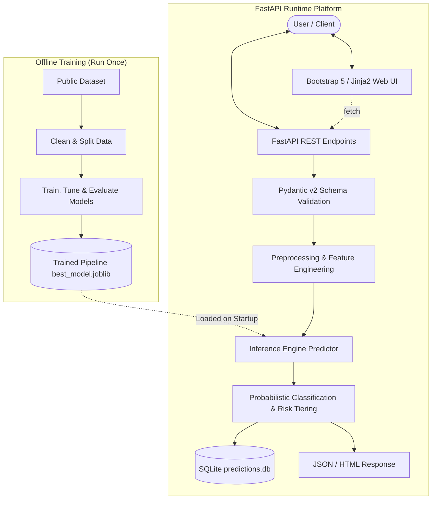

# Fake Social Media Account Detection Using Machine Learning
An end-to-end machine learning system and FastAPI web platform for detecting fake, spam, and bot accounts using public profile attributes and behavioral metadata.

---

## 1. Project Title
**Fake Social Media Account Detection Using Machine Learning**  
*An interpretable, feature-engineered classification system and FastAPI web interface for social media account verification and risk assessment.*

---

## 2. Overview
Social media platforms are frequently targeted by automated bots, fake spam accounts, and malicious impersonators. These accounts are deployed to artificially inflate follower counts, distribute misinformation, execute phishing schemes, and manipulate public opinion.

This project delivers an end-to-end, reproducible Machine Learning (ML) solution and production-grade **FastAPI web application** designed to classify accounts as either **Genuine** or **Fake/Bot** based on tabular profile attributes, activity signals, and derived network patterns. The model processes structured feature vectors without requiring invasive scraping or access to private user data.

### Real-World Use Cases
- **Trust & Safety Triage:** Serves as a first-line filter for moderation teams to prioritize high-risk accounts for human verification.
- **Fake-Follower Audits:** Helps digital marketing and brand safety analysts assess influencer audience integrity prior to commercial sponsorships.
- **Fraud & Registration Screening:** Evaluates new or flagged registrations against known bot behavioral footprints during platform onboarding.
- **Academic Research:** Enables empirical study of social bot architectures, account lifecycle patterns, and evolving manipulation tactics using standardized public datasets.

---

## 3. Objectives
- Develop an end-to-end classification pipeline comparing baseline, tree-based, and ensemble algorithms on public social media datasets.
- Ensure strict separation between model training and evaluation using leak-free preprocessing transformations (`ColumnTransformer` and `Pipeline`).
- Deliver a responsive, student-friendly **FastAPI web application** with server-rendered Jinja2 templates and Bootstrap 5 supporting both single-account manual prediction and bulk CSV batch processing.
- Provide risk-stratified predictions (Low, Review, High) paired with calibrated class probabilities and local feature attribution.
- Establish a reproducible engineering baseline with fixed random seeds, pinned dependencies, modular architecture, and comprehensive unit and integration tests.

---

## 4. Scope

### v1 (Current Scope - FastAPI Platform)
- **FastAPI Core & REST Endpoints:** High-performance REST API with OpenAPI documentation at `/docs`.
- **Manual Input Form:** Single-account inspection UI accepting standard profile fields with instant prediction.
- **CSV Batch Upload & Download:** Ingestion of multi-account CSV files, schema validation, batch inference, interactive Chart.js doughnut chart, and result export with risk tags.
- **Probabilistic Classification:** Prediction label (`Genuine` vs. `Fake/Bot`) accompanied by confidence probability.
- **Three-Tier Risk Level:** Rule- and threshold-based assignment (`Low Risk`, `Needs Review`, `High Risk`).
- **Feature Contribution:** Identification and display of the top profile attributes driving the classification outcome.
- **Model Performance Page:** Interactive visualization of cross-validation metrics, confusion matrices, ROC curves, and PR curves.
- **Exploratory Data Analysis (EDA) Page:** Visual summaries displaying feature distributions, class balance, and correlation heatmaps.
- **Prediction History (SQLite):** Embedded SQLite database persisting and auditing all single and batch inference operations.

### Later / Optional Additions
- **Containerization:** Production Docker image for container orchestration.
- **Second-Platform Model:** Dedicated Twitter/X model operating on platform-specific schema without cross-polluting datasets.
- **Text & NLP Features:** Natural language analysis on user biographies (sentiment, word embeddings, linguistic cues).

### Explicitly Out of Scope
- **Live Platform Scraping:** No headless browser or automated scraping against live social media platforms.
- **Private Account Inspection:** No capability or attempt to view private profiles, protected posts, or direct messages.
- **Real-Time Feed Monitoring:** No real-time event streaming or automated account suspension workflows.

---

## 5. Requirements

### Functional Requirements
- **FR1 (Manual Prediction):** The system must accept user-entered account profile attributes via web form or REST API (`POST /api/predict`) and return a classification.
- **FR2 (CSV Batch Processing):** The system must ingest CSV files containing account records (`POST /api/predict-batch`), validate the schema, check bounds, and perform batch inference.
- **FR3 (Inference Output):** Every prediction must output the binary label (`Genuine` or `Fake/Bot`), the predicted probability, a risk tier (`Low Risk`, `Needs Review`, `High Risk`), and top contributing features.
- **FR4 (Model Performance Dashboard):** The application must provide a dedicated view presenting validation metrics, confusion matrices, and ROC/PR curves from offline evaluation.
- **FR5 (EDA Dashboard):** The application must provide interactive visual summaries of dataset distributions, feature correlations, and class splits.
- **FR6 (Prediction History):** The system persists prediction inputs, timestamps, and model outputs into a lightweight SQLite database for auditing, with clear capability.
- **FR7 (Exportable Results):** The system must allow users to download batch inference results as an annotated CSV file.

### Non-Functional Requirements
- **Latency:** Single-account inference response time must be under 1.0 second on standard consumer hardware.
- **Reproducibility:** All preprocessing, feature generation, data splitting, and model training operations must use fixed random seeds (`random_state=42`) with pinned dependencies.
- **Modularity:** Source code must follow strict separation of concerns (configuration, loading, preprocessing, training, inference, API routes).
- **Error Handling:** All user inputs and uploaded files must undergo strict validation with friendly, descriptive error messages (no raw stack traces).
- **Tooling Constraints:** The project strictly utilizes free, open-source software libraries.
- **Privacy & Data Minimization:** No personal data or credentials are saved or transmitted to external third-party services.

---

## 6. Tech Stack

| Tool | Purpose | Required? |
| :--- | :--- | :--- |
| **Python** (3.12+) | Core programming language | Required |
| **FastAPI** | High-performance modern web framework and REST API engine | Required |
| **Uvicorn** | Lightning-fast ASGI web server | Required |
| **Jinja2** | Server-side template rendering for clean frontend pages | Required |
| **Bootstrap 5 (CDN)** | Responsive CSS styling framework (no Node.js build step needed) | Required |
| **Pandas** | Tabular data manipulation, aggregation, and batch processing | Required |
| **NumPy** | Numerical array operations and mathematical transformations | Required |
| **Scikit-learn** | Preprocessing pipelines, standard ML algorithms, and metrics | Required |
| **SHAP** | TreeSHAP per-prediction explainability and feature contribution attribution | Required |
| **Pillow & PyTesseract** | In-memory image processing and local OCR extraction | Required |
| **Anthropic (Optional)** | Claude Vision backend for high-fidelity screenshot extraction | Optional |
| **Matplotlib & Seaborn** | Static visualization generation for EDA and evaluation reports | Required |
| **joblib** | Serialization and loading of trained pipelines and transformers | Required |
| **pytest & httpx** | Automated test suite for data validation, inference, and API endpoints | Required |
| **SQLite** | Local embedded relational database for prediction history | Required |

---

## 7. Datasets

### Core Principle
**Strict platform segregation:** Social media platforms differ fundamentally in their profile architectures, network dynamics, and interaction semantics. Models are strictly trained on single-platform schemas.

### Dataset Source
- **Benchmark Source:** Instagram Fake Spammer Genuine Accounts (mirrored on GitHub from Kaggle `free4ever1/instagram-fake-spammer-genuine-accounts`).
- **Raw Files:** `data/raw/train.csv` (576 rows) and `data/raw/test.csv` (120 rows).
- **Combined Cleaned Records:** 692 deduplicated rows (4 duplicate rows removed).
- **Split:** Stratified 80/20 train/test partition (`RANDOM_STATE = 42`).
  - `data/processed/train.csv`: 553 rows (277 genuine, 276 fake)
  - `data/processed/test.csv`: 139 rows (70 genuine, 69 fake)

---

## 8. Machine Learning Approach & Metrics

### Production Champion
- **Selected Model:** **Random Forest Classifier** (`n_estimators=100`, `max_depth=8`)
- **Selection Rationale:** Highest cross-validated Recall (94.56%) and F1-Score (94.05%) across 5-fold CV folds.

### Hold-out Test Performance (139 Samples)
- **Accuracy:** 92.81%
- **Precision:** 95.38%
- **Recall:** 89.86%
- **F1-Score:** 92.54%
- **ROC-AUC Score:** 0.9812
- **PR-AUC Score:** 0.9801

---

## 9. System Architecture



---

## 10. API Endpoints

| Method | Endpoint | Description |
| :--- | :--- | :--- |
| `GET` | `/health` | Server status, model readiness, and metadata |
| `POST` | `/api/predict` | Single account risk prediction |
| `POST` | `/api/predict-batch` | Upload CSV for batch verification with summary |
| `GET` | `/api/predict-batch/template` | Download sample batch template CSV |
| `POST` | `/api/predict-batch/download` | Bulk audit and download annotated CSV |
| `GET` | `/api/history` | Fetch past prediction audit logs (supports `?limit=50`) |
| `DELETE` | `/api/history` | Clear prediction history database |
| `GET` | `/api/metrics` | Retrieve offline test metrics & CV benchmarks |
| `GET` | `/api/eda-summary` | Summary statistics and class counts of train data |

### Example Request (`POST /api/predict`)
```json
{
  "profile pic": 1,
  "nums/length username": 0.05,
  "fullname words": 2,
  "nums/length fullname": 0.0,
  "name==username": 0,
  "description length": 55,
  "external URL": 0,
  "private": 0,
  "#posts": 150,
  "#followers": 600,
  "#follows": 320
}
```

### Example Response
```json
{
  "label": "Genuine",
  "is_fake": 0,
  "fake_probability": 0.0028,
  "genuine_probability": 0.9972,
  "risk_level": "Low Risk",
  "top_features": [
    {
      "feature": "#followers",
      "value": 650.0,
      "contribution": -0.0902,
      "direction": "Toward Genuine",
      "type": "local"
    },
    {
      "feature": "#posts",
      "value": 180.0,
      "contribution": -0.0869,
      "direction": "Toward Genuine",
      "type": "local"
    },
    {
      "feature": "nums/length username",
      "value": 0.0,
      "contribution": -0.0535,
      "direction": "Toward Genuine",
      "type": "local"
    },
    {
      "feature": "follower_following_ratio",
      "value": 2.0249,
      "contribution": -0.0484,
      "direction": "Toward Genuine",
      "type": "local"
    },
    {
      "feature": "profile pic",
      "value": 1.0,
      "contribution": -0.0478,
      "direction": "Toward Genuine",
      "type": "local"
    }
  ],
  "timestamp": "2026-11-06 14:22:06"
}
```

---

## 11. Folder Structure

```text
FSMD/
├── app_api/                 # Production FastAPI web application
│   ├── __init__.py
│   ├── main.py              # Application entrypoint, routes, and lifespan handler
│   ├── schemas.py           # Pydantic v2 validation models
│   ├── quickfill.py         # Text/handle parsing & feature derivation logic
│   ├── screenshot.py        # In-memory image OCR & Claude fallback logic
│   ├── static/              # Static assets
│   │   ├── css/style.css    # Custom styling
│   │   └── js/app.js        # Vanilla JS client logic & Chart.js integration
│   └── templates/           # Jinja2 HTML templates
│       ├── base.html        # Layout wrapper & navigation
│       ├── index.html       # Landing page with headline metrics
│       ├── predict.html     # Single account prediction form (Screenshot, QuickFill, Advanced)
│       ├── batch.html       # CSV batch upload & audit dashboard
│       ├── performance.html # Model metrics, benchmarks, and evaluation plots
│       ├── eda.html         # Exploratory data analysis & statistical distributions
│       └── history.html     # SQLite prediction audit log
├── data/
│   ├── raw/                 # Unmodified raw benchmark datasets
│   ├── processed/           # Cleaned, split train.csv and test.csv
│   └── sample/              # sample_batch_accounts.csv template
├── models/
│   ├── best_model.joblib    # Serialized champion Random Forest pipeline
│   └── metadata.json        # Training metadata, features list, and CV scores
├── reports/                 # Confusion matrix, ROC/PR curves, and EDA plots
├── src/
│   ├── config.py            # Global project paths and constants
│   ├── data_loader.py       # Raw CSV loading helpers
│   ├── preprocessing.py     # Deduplication, dtype fixing, and split logic
│   ├── features.py          # Feature engineering ratios and indicators
│   ├── train.py             # 5-fold CV training and model selection
│   ├── evaluate.py          # Test set evaluation and diagnostic plotting
│   ├── predict.py           # Core inference engine, SHAP local attributions & risk assigner
│   └── database.py          # SQLite database connection and query routines
├── tests/
│   ├── test_preprocessing.py # Cleaning and split unit tests
│   ├── test_predict.py       # Inference reproducibility and logic tests
│   ├── test_quickfill.py     # Quick fill parsing unit tests
│   ├── test_screenshot.py    # Screenshot memory-only OCR tests
│   └── test_api.py           # FastAPI endpoint and HTML route test suite
├── run.ps1                  # Single-command PowerShell app launch script
├── run_tests.ps1            # Single-command PowerShell test runner script
├── Procfile                 # Deployment command for web servers
├── render.yaml              # Render deployment configuration
├── requirements.txt         # Pinned project dependencies
└── README.md                # Master documentation
```

---

## 12. Getting Started

### Installation
1. Clone or open the repository:
   ```powershell
   cd FSMD
   ```
2. Activate your virtual environment:
   ```powershell
   .\.venv\Scripts\Activate.ps1
   ```
3. Install pinned dependencies:
   ```powershell
   pip install -r requirements.txt
   ```

### Run the Web Application
Launch with the one-command PowerShell script:
```powershell
.\run.ps1
```
Or directly using Uvicorn:
```powershell
.\.venv\Scripts\uvicorn.exe app_api.main:app --host 127.0.0.1 --port 8000 --reload
```
- **Web Interface:** Open [http://127.0.0.1:8000](http://127.0.0.1:8000) in your browser.
- **Interactive Swagger API Docs:** Open [http://127.0.0.1:8000/docs](http://127.0.0.1:8000/docs).

### Run Test Suite
Run the automated test suite (45 unit, integration, and screenshot OCR tests) with the PowerShell runner:
```powershell
.\run_tests.ps1
```
Or via pytest:
```powershell
.\.venv\Scripts\pytest.exe -v
```

---

## 13. Screenshot Autofill & OCR Extraction Architecture

The system supports memory-only screenshot ingestion (`POST /api/screenshot/extract`) to automatically populate the 11 model features from any Instagram-style profile screenshot.

### Supported Backends & Fallback Logic
1. **Primary Backend (Anthropic Claude Vision):**
   - Activated automatically if `ANTHROPIC_API_KEY` is present in the environment or `.env` file (configured via `CLAUDE_MODEL`, default: `claude-3-haiku-20240307`).
   - Parses complex mobile UI layouts, handles abbreviations (`1.2K` -> `1200`, `3.4M` -> `3400000`), verifies whether the image is an Instagram profile, and extracts fields with high fidelity.
   - **Privacy Notice:** When the Claude backend is used, image bytes are sent in-memory to Anthropic's API. A prominent disclosure is surfaced in the UI.

2. **Local Fallback Backend (Multi-Stage Tesseract OCR):**
   - Active when no Claude API key is configured, or automatically invoked if the Claude API fails, experiences rate limits, or network errors.
   - Utilizes multi-stage image preprocessing variants:
     - 2x upscale with autocontrast
     - Inverted luminance for Dark Mode mobile screenshots
     - 3x upscale high-contrast thresholding
   - Uses `pytesseract.image_to_data` with fuzzy matching (`difflib >= 0.7`) to locate `posts`, `followers`, and `following` labels, reading numbers directly above (or beside) the label.
   - Estimates avatar type (custom photo vs default grey silhouette) using pixel color channel variance and near-grey statistics without face recognition.
   - Returns `null` and highlights unlocated fields for human confirmation; never returns false zeros.

### Capabilities & Limitations Comparison Matrix

| Feature / Capability | Claude Vision Backend | Local Tesseract OCR Backend |
| :--- | :--- | :--- |
| **Dark Mode & Light Mode** | Supported seamlessly | Supported (auto-inversion preprocessing) |
| **K / M Multiplier Parsing** | Automatic conversion (`1.2K` -> 1200) | Regex & metric parser (`1.2K` -> 1200) |
| **Layout Flexibility** | Very High (handles any phone resolution) | High (number-above or number-beside) |
| **Avatar Detection** | High (visual silhouette detection) | Moderate (pixel statistics heuristic) |
| **Network Requirement** | Requires Internet & Anthropic API Key | 100% Offline / Local processing |
| **Processing Privacy** | Processed in-memory via Anthropic API | Processed 100% locally in-memory |
| **Image Persistence** | Never written to disk or database | Never written to disk or database |

---

## 14. Deployment Notes (Render)

- **Build Command:** `pip install -r requirements.txt`
- **Start Command:** `uvicorn app_api.main:app --host 0.0.0.0 --port $PORT`
- **Deployment Files:** Provided in [`Procfile`](file:///c:/Users/sraja/OneDrive/Desktop/FSMD/Procfile) and [`render.yaml`](file:///c:/Users/sraja/OneDrive/Desktop/FSMD/render.yaml).
- **Free-Tier Operational Behavior:** On Render free instances, the service spins down after 15 minutes of inactivity; initial wake-up may take 30-50 seconds. The filesystem is ephemeral, meaning `predictions.db` (SQLite audit history) resets when the container restarts.

---

## 14. Limitations & Ethics

- **Dataset Size:** The model is trained on ~700 real-world benchmark records and evaluated on a 139-sample hold-out test set. While metrics are high on this benchmark (~92.8% test accuracy), accuracy represents a prototype estimate and will degrade against live adversarial bots.
- **Probabilistic Output:** Classifications are statistical probabilities, not definitive proof of account malice or ownership.
- **No Live Access:** The system analyzes only user-supplied or batch-uploaded features without inspecting live or private account data.
- **Responsible Use:** Automated classifications must never be used alone to ban or penalize user accounts without human-in-the-loop verification.

---

## 15. Licence
**TBD**
